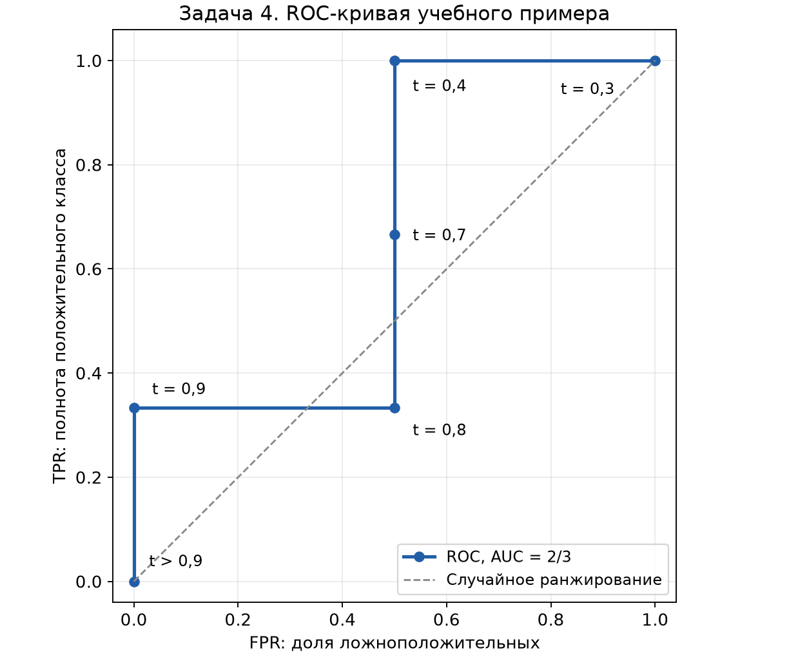
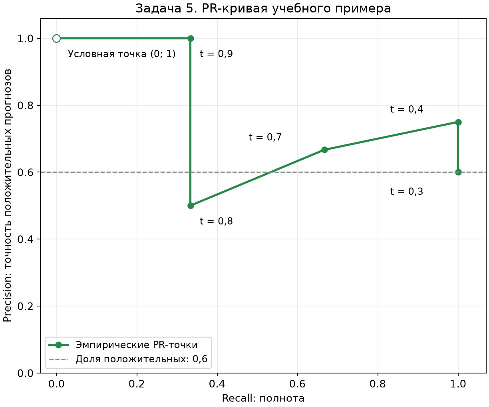

# Задачи к защите: алгоритмы и разобранные примеры

Во вложении перечислены **10 типов задач без конкретных числовых условий**. Ниже для каждого типа приведены способ решения и полностью разобранный пример. **Пример 1 использует сохранённую матрицу SVM из лабораторной; примеры 2–10 учебные и не являются результатами Rice.**

Во всех матрицах строки – истинные классы, столбцы – прогнозы. Для бинарной классификации при положительном классе 1 порядок матрицы: `[[TN, FP], [FN, TP]]`.

## 1. Бинарная матрица: Precision, Recall, F1 каждого класса и общая Accuracy

**Условие примера.** Матрица SVM из текущей лабораторной:

| Истина / прогноз | Osmancik (0) | Cammeo (1) |
| :--- | ---: | ---: |
| Osmancik (0) | 404 | 32 |
| Cammeo (1) | 25 | 301 |

**Алгоритм:** выбрать положительный класс → определить TP, FP, FN, TN → подставить в формулы → повторить, поменяв положительный класс. Accuracy при смене положительного класса не меняется.

**Положительный класс – Cammeo (1):** TP=301, FP=32, FN=25, TN=404.

$$
P_1=\frac{301}{301+32}=0{,}903904,\qquad
R_1=\frac{301}{301+25}=0{,}923313,
$$

$$
F1_1=\frac{2\cdot301}{2\cdot301+32+25}=0{,}913505.
$$

**Положительный класс – Osmancik (0):** TP=404, FP=25, FN=32, TN=301.

$$
P_0=\frac{404}{404+25}=0{,}941725,\qquad
R_0=\frac{404}{404+32}=0{,}926606,
$$

$$
F1_0=\frac{2\cdot404}{2\cdot404+25+32}=0{,}934104.
$$

**Общая точность:**

$$
Accuracy=\frac{404+301}{404+32+25+301}
=\frac{705}{762}=0{,}925197\approx92{,}52\%.
$$

Ошибка, которой следует избегать: после смены положительного класса нельзя оставить прежние FP и FN – они меняются местами вместе с TP/TN.

## 2. Многоклассовая матрица: показатели классов, micro и macro

**Условие примера.** Три класса и 40 объектов:

| Истина / прогноз | A | B | C | Всего истинных |
| :--- | ---: | ---: | ---: | ---: |
| A | 8 | 1 | 1 | 10 |
| B | 2 | 6 | 2 | 10 |
| C | 0 | 1 | 19 | 20 |
| Всего прогнозов | 10 | 8 | 22 | 40 |

Для каждого класса k:

$$
TP_k=C_{kk},\quad
FN_k=\text{сумма строки }k-TP_k,\quad
FP_k=\text{сумма столбца }k-TP_k.
$$

| Класс | TP | FP | FN | Precision | Recall | F1 |
| :--- | ---: | ---: | ---: | ---: | ---: | ---: |
| A | 8 | 2 | 2 | 8/10 = 0,800000 | 8/10 = 0,800000 | 16/20 = 0,800000 |
| B | 6 | 2 | 4 | 6/8 = 0,750000 | 6/10 = 0,600000 | 12/18 = 0,666667 |
| C | 19 | 3 | 1 | 19/22 = 0,863636 | 19/20 = 0,950000 | 38/42 = 0,904762 |

**Macro – одинаковый вес каждого класса:**

$$
P_{macro}=\frac{0{,}8+0{,}75+0{,}863636}{3}=0{,}804545,
$$

$$
R_{macro}=\frac{0{,}8+0{,}6+0{,}95}{3}=0{,}783333,
$$

$$
F1_{macro}=\frac{0{,}8+0{,}666667+0{,}904762}{3}=0{,}790476.
$$

**Micro – сначала складываем счётчики:** ΣTP=33, ΣFP=7, ΣFN=7.

$$
P_{micro}=R_{micro}=\frac{33}{40}=0{,}825,
\qquad F1_{micro}=\frac{66}{66+7+7}=0{,}825.
$$

Accuracy также равна 33/40=0,825. Совпадение характерно для однозначной многоклассовой задачи при включении всех классов. Macro ниже, поскольку слабая полнота класса B получает такой же вес, как качество более многочисленного C.

**Важно:** macro-F1 рассчитывается по F1 отдельных классов; брать гармоническое среднее macro-Precision и macro-Recall вместо этого нельзя.

## 3. Энтропия узлов, взвешенная энтропия и прирост информации

**Условие примера.** В исходном узле 10 объектов: 6 положительных и 4 отрицательных. После разделения:

- левый узел: 5 объектов, из них 4 положительных и 1 отрицательный;
- правый узел: 5 объектов, из них 2 положительных и 3 отрицательных.

Проверка: размеры дочерних узлов и количества каждого класса суммируются в исходные.

Энтропия в битах:

$$
H=-\sum_k p_k\log_2p_k,\qquad 0\log_2 0=0.
$$

**Родитель:**

$$
H_{parent}=-0{,}6\log_2 0{,}6-0{,}4\log_2 0{,}4=0{,}970951.
$$

**Левый узел:**

$$
H_L=-0{,}8\log_2 0{,}8-0{,}2\log_2 0{,}2=0{,}721928.
$$

**Правый узел:**

$$
H_R=-0{,}4\log_2 0{,}4-0{,}6\log_2 0{,}6=0{,}970951.
$$

**После разбиения:**

$$
H_{after}=\frac5{10}H_L+\frac5{10}H_R=0{,}846439.
$$

**Прирост информации:**

$$
IG=H_{parent}-H_{after}=0{,}124511\text{ бита}.
$$

Из допустимых разбиений выбирают максимальный IG. Взвешивать нужно размерами узлов, а не всегда усреднять пополам; здесь веса 1/2 получились только из-за одинаковых размеров.

## 4. Пороги, TPR/FPR, ROC-кривая и AUC методом трапеций

**Условие примера.** Истинные метки и вероятности положительного класса:

| Объект | y | Оценка p |
| :--- | ---: | ---: |
| A | 1 | 0,9 |
| B | 0 | 0,8 |
| C | 1 | 0,7 |
| D | 1 | 0,4 |
| E | 0 | 0,3 |

Положительных P=3, отрицательных N=2. Правило: прогноз 1, если **p≥t**.

**Алгоритм:** упорядочить уникальные оценки по убыванию → начать с порога выше максимума → последовательно включать объекты в положительные прогнозы → считать `TPR=TP/P`, `FPR=FP/N`. Равные оценки включаются вместе.

| Порог t | TP | FP | FN | TN | TPR | FPR |
| :--- | ---: | ---: | ---: | ---: | ---: | ---: |
| Выше 0,9 | 0 | 0 | 3 | 2 | 0 | 0 |
| 0,9 | 1 | 0 | 2 | 2 | 1/3 | 0 |
| 0,8 | 1 | 1 | 2 | 1 | 1/3 | 1/2 |
| 0,7 | 2 | 1 | 1 | 1 | 2/3 | 1/2 |
| 0,4 | 3 | 1 | 0 | 1 | 1 | 1/2 |
| 0,3 | 3 | 2 | 0 | 0 | 1 | 1 |

ROC-точки записываются в порядке **(FPR, TPR)**:

`(0,0) → (0,1/3) → (1/2,1/3) → (1/2,2/3) → (1/2,1) → (1,1)`.



Метод трапеций:

$$
AUC\approx\sum_i(x_{i+1}-x_i)\frac{y_i+y_{i+1}}2.
$$

Вертикальные отрезки дают нулевой вклад. Поэтому:

$$
AUC=\frac12\cdot\frac13+\frac12\cdot1
=\frac16+\frac12=\frac23\approx0{,}666667.
$$

Ранжирование лучше случайного, но далеко от идеального. Проверка по парам: из 3×2=6 пар «положительный – отрицательный» положительный расположен выше в четырёх; 4/6=2/3.

Проверочный код:

```python
import numpy as np
from sklearn.metrics import roc_curve, roc_auc_score

y_true = [1, 0, 1, 1, 0]
scores = [0.9, 0.8, 0.7, 0.4, 0.3]
fpr, tpr, thresholds = roc_curve(y_true, scores, drop_intermediate=False)
print(np.trapezoid(tpr, fpr))
print(roc_auc_score(y_true, scores))
```

Нельзя вычислить полноценный ROC-AUC по единственной матрице при одном пороге: нужны оценки или точки для разных порогов.

## 5. Precision/Recall при порогах, PR-кривая и выбор порога

**Условие примера.** Используем те же пять объектов из задачи 4.

$$
Precision=\frac{TP}{TP+FP},\qquad Recall=\frac{TP}{3}.
$$

| Порог t | TP | FP | Precision | Recall | F1 |
| :--- | ---: | ---: | ---: | ---: | ---: |
| Выше 0,9 | 0 | 0 | Не определена | 0 | 0 |
| 0,9 | 1 | 0 | 1,000000 | 0,333333 | 0,500000 |
| 0,8 | 1 | 1 | 0,500000 | 0,333333 | 0,400000 |
| 0,7 | 2 | 1 | 0,666667 | 0,666667 | 0,666667 |
| 0,4 | 3 | 1 | 0,750000 | 1,000000 | 0,857143 |
| 0,3 | 3 | 2 | 0,600000 | 1,000000 | 0,750000 |



По горизонтали PR-кривой – **Recall**, по вертикали – **Precision**. При отсутствии положительных прогнозов Precision по формуле не определена; точка (0,1), которую добавляют библиотеки для кривой, – соглашение об отображении, а не доказательство идеального классификатора.

**Требование 1: Recall≥0,9, затем максимальная Precision.** Подходят t=0,4 и t=0,3. Выбираем **t=0,4**: полнота 1 при Precision=0,75 вместо 0,60. Вообще то же решение дают пороги в интервале (0,3; 0,4].

**Требование 2: Precision≥0,8, затем максимальная Recall.** Среди непустых положительных прогнозов подходит **t=0,9**: Precision=1, Recall=1/3. Порог выше максимума нельзя объявлять хорошим решением из-за условной точки (0,1).

Precision при уменьшении порога не обязана изменяться монотонно: на шаге 0,8→0,7 добавляется верный положительный объект, и она возрастает. Recall при расширении положительных прогнозов не уменьшается.

В настоящей работе порог выбирают на validation, а затем фиксируют для test. Average Precision и трапецеидальная площадь PR-кривой – разные способы обобщения её качества.

## 6. Перевод словесного условия в TP, TN, FP, FN

**Условие примера.** Из 100 зёрен 30 относятся к Cammeo, 70 – к Osmancik. Найдены 24 из 30 Cammeo. Ещё 8 Osmancik ошибочно признаны Cammeo.

Положительный класс – Cammeo:

- TP=24 – найденные Cammeo;
- FN=30−24=6 – пропущенные Cammeo;
- FP=8 – ложные положительные ответы;
- TN=70−8=62 – правильно отклонённые Osmancik.

Проверяем сумму: 24+6+8+62=100.

| Истина / прогноз | Osmancik | Cammeo |
| :--- | ---: | ---: |
| Osmancik | 62 | 8 |
| Cammeo | 6 | 24 |

$$
Accuracy=\frac{24+62}{100}=0{,}86,
\quad Precision=\frac{24}{24+8}=0{,}75,
$$

$$
Recall=\frac{24}{24+6}=0{,}8,
\quad F1=\frac{48}{48+8+6}=0{,}774194.
$$

**Ответ:** Accuracy 86%, Precision 75%, Recall 80%, F1≈77,42%. Сначала нужно явно выбрать положительный класс, затем переводить каждую фразу условия в счётчик.

## 7. Выбор модели с учётом требований к ошибкам

**Условие примера.** Все модели проверены на одних 1000 объектах: 100 положительных и 900 отрицательных. Требуется **Recall≥0,95**; пропустить положительный объект значительно хуже ложной тревоги.

| Модель | TP | FP | FN | TN | Accuracy | Precision | Recall | F1 |
| :--- | ---: | ---: | ---: | ---: | ---: | ---: | ---: | ---: |
| A | 80 | 10 | 20 | 890 | 0,970 | 0,888889 | 0,800 | 0,842105 |
| B | 96 | 40 | 4 | 860 | 0,956 | 0,705882 | **0,960** | 0,813559 |
| C | 92 | 20 | 8 | 880 | **0,972** | 0,821429 | 0,920 | **0,867925** |

**Выбор – B:** только она удовлетворяет ограничению полноты. Наибольшая Accuracy или F1 у другой модели не отменяет заданного требования.

Если цена FN равна 50, а FP – 1, суммарный штраф:

$$
Cost=50FN+FP.
$$

- A: 50×20+10=1010;
- B: 50×4+40=240;
- C: 50×8+20=420.

По стоимости снова выбирается B. Её меньшая Precision означает больше ложных тревог, но это допустимо при данных приоритетах.

В реальном подборе ограничения и цену ошибок определяют заранее, решение выбирают по validation, а независимым test подтверждают результат. Если условия задачи изменятся, может измениться и предпочтительная модель.

## 8. Анализ графиков loss и Accuracy

**Учебный пример показателей по эпохам:**

| Эпоха | Train loss | Validation loss | Train accuracy | Validation accuracy |
| ---: | ---: | ---: | ---: | ---: |
| 1 | 0,70 | 0,72 | 0,55 | 0,54 |
| 10 | 0,35 | 0,37 | 0,85 | 0,83 |
| 30 | 0,15 | **0,32** | 0,95 | **0,86** |
| 60 | 0,05 | 0,55 | 0,99 | 0,82 |

**Интерпретация:** в начале обе ошибки снижаются, обе Accuracy растут – сеть обучается полезной зависимости. После 30-й эпохи train продолжает улучшаться, а validation ухудшается. Это признаки переобучения. По критерию validation loss предпочтительна 30-я эпоха из показанных, а не 60-я.

Возможные изменения:

- ограничить число эпох или применить EarlyStopping с восстановлением лучших весов;
- уменьшить сеть, добавить L2 или Dropout;
- увеличить объём или разнообразие данных, проверить качество меток;
- сравнить варианты на validation, не подбирать параметры по test.

**Недообучение:** обе Accuracy низкие, обе ошибки высокие и почти не меняются. Возможны слишком простая модель, неудачный learning rate, недостаточное обучение или проблемы с признаками. Нужны проверка данных, изменение шага, архитектуры или числа эпох.

**Нормальная сходимость:** ошибки обеих выборок снижаются и стабилизируются, большого растущего разрыва нет. Это благоприятный признак, но не гарантия качества на любых будущих данных.

Validation accuracy выше train accuracy сама по себе не доказывает утечку: могут различаться сложность выборок, режимы регуляризации и способ усреднения метрик по батчам. В фактической лабораторной веса выбираются по конфигурации и её последней эпохе; EarlyStopping в выполненном коде нет.

## 9. Пошаговое построение небольшого дерева

**Условие примера.** Один числовой признак, бинарная цель:

| x | 1 | 2 | 3 | 4 | 5 | 6 |
| :--- | ---: | ---: | ---: | ---: | ---: | ---: |
| y | 0 | 0 | 1 | 1 | 0 | 1 |

Критерий – энтропия. Допустимы пороги между соседними x. Максимальная глубина – 2, корень имеет глубину 0; при равенстве классов в листе выбираем 0.

**Шаг 1.** В корне по три объекта каждого класса: H=1.

| Порог | Взвешенная энтропия после разбиения | Прирост информации |
| ---: | ---: | ---: |
| 1,5 | 0,809125 | 0,190875 |
| **2,5** | **0,540852** | **0,459148** |
| 3,5 | 0,918296 | 0,081704 |
| 4,5 | 1,000000 | 0 |
| 5,5 | 0,809125 | 0,190875 |

Выбираем **x≤2,5**. Левый узел содержит два нуля и становится чистым листом класса 0.

**Шаг 2.** Справа остаются x=3,4,5,6 с метками 1,1,0,1. Энтропия равна H(3/4,1/4)=0,811278.

| Порог в правом узле | Взвешенная энтропия | Прирост информации |
| ---: | ---: | ---: |
| 3,5 | 0,688722 | 0,122556 |
| **4,5** | **0,500000** | **0,311278** |
| 5,5 | 0,688722 | 0,122556 |

Выбираем **x≤4,5**. Получаем дерево:

```text
x ≤ 2,5?
├── да: класс 0                  [0, 0]
└── нет: x ≤ 4,5?
    ├── да: класс 1              [1, 1]
    └── нет: класс 0             [0, 1], равенство → 0
```

Последний лист неоднороден, но глубина 2 уже достигнута. Для нового **x=3,7**: первое условие ложно, второе истинно → **класс 1**. При x=5,2 получится класс 0 по заданному правилу равенства.

Правила остановки проверяются при каждом шаге: чистый узел, глубина, минимальный размер узла/листа и отсутствие допустимого полезного разбиения.

## 10. Прямой проход небольшой полносвязной сети

**Условие примера.** Вход x=(1,2). Два скрытых нейрона ReLU, один выход sigmoid. Веса строками соответствуют нейронам:

$$
W_1=\begin{pmatrix}0{,}5&-0{,}2\\-0{,}3&0{,}8\end{pmatrix},
\quad b_1=\begin{pmatrix}0{,}1\\-0{,}5\end{pmatrix},
\quad W_2=\begin{pmatrix}1{,}2&-0{,}7\end{pmatrix},\quad b_2=0{,}2.
$$

**Скрытый нейрон 1:**

$$
z_1=0{,}5\cdot1-0{,}2\cdot2+0{,}1=0{,}2,
\qquad h_1=\max(0;0{,}2)=0{,}2.
$$

**Скрытый нейрон 2:**

$$
z_2=-0{,}3\cdot1+0{,}8\cdot2-0{,}5=0{,}8,
\qquad h_2=\max(0;0{,}8)=0{,}8.
$$

**Выход:**

$$
z=1{,}2\cdot0{,}2-0{,}7\cdot0{,}8+0{,}2=-0{,}12,
$$

$$
p=\sigma(-0{,}12)=\frac1{1+e^{0{,}12}}\approx0{,}470036.
$$

При пороге 0,5 получаем **класс 0**, поскольку p<0,5. Вероятность класса 1 – около 47%; это не значение loss и не Accuracy.

Проверка:

```python
import numpy as np

x = np.array([1.0, 2.0])
W1 = np.array([[0.5, -0.2], [-0.3, 0.8]])
b1 = np.array([0.1, -0.5])
h = np.maximum(W1 @ x + b1, 0)
z = np.array([1.2, -0.7]) @ h + 0.2
p = 1 / (1 + np.exp(-z))
print(h, p, int(p >= 0.5))
```

Порядок действий: взвешенная сумма со смещением → активация скрытого слоя → следующая взвешенная сумма → выходная активация → правило выбора класса. Если вход по условию должен быть стандартизован, стандартизацию выполняют до этих действий по заданным обучающим параметрам.
